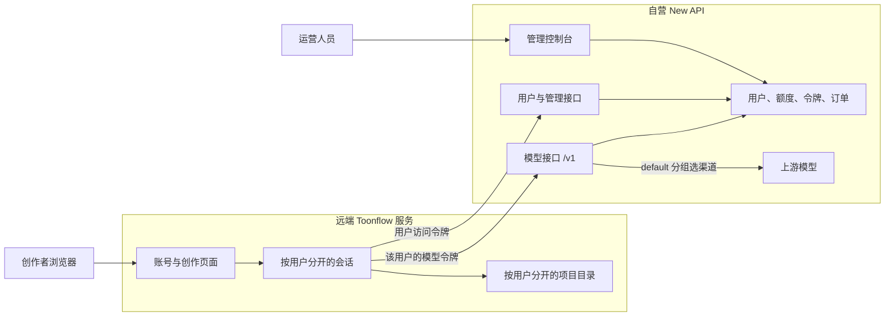

# 自营云端 v1

整理日期：2026-11-18。状态：已确定用一台远端服务器做 SaaS。开发按「开发顺序」从会话做起。图片和视频等评审项 3 确认后再做。本文只确定方案，不表示已经开工。

## 范围

产品形态是 SaaS：多个 C 端用户通过网页使用同一台远端 Toonflow 服务。这里的多租户指这台云端上的多个用户同时存在，各自有登录、额度、项目和磁盘上的资产目录。A 登录之后，B 再登录，不能覆盖 A 的会话、密钥或项目。前期不维护六种桌面安装包。

仓库里的 `packages/multiTenant` 是本地服务的 SQL 账号隔离，工作区仍在那台机器的磁盘上。它不在本版范围，也不能用来实现这台云端。

New API 单独部署，承担三件事：云端用户认证与鉴权、额度与充值账本、模型网关和上游渠道运营。用户身份、额度、充值记录和模型令牌只存在 New API。Toonflow 不另建用户表，也不保存第二份余额。部署版本锁定为 `v1.0.0-rc.51`，见「New API 版本」。本方案所依据的 Toonflow 基线是上游标签 `v2.0.10`，见「Toonflow 基线」。

`settings.json` 只保留这台服务自己的配置，例如 New API 根地址，以及仍属于整站的 MCP、网络和桌面更新。它不保存任何一个 C 端用户的登录令牌、`sk-`、外观、引导完成状态或智能体提示词。

## 现有工程不能直接承接

当前云端账号模式把登录令牌放在一份 `settings.json` 的 `toonflowAccount` 里，并把媒体供应商写成数据目录中的一个 `providers/toonflow.ts`。远端部署时，项目文件又落在同一个 `workspaces` 目录。多个浏览器用户共用这一台服务时，后一次登录和保存会换掉前一个用户的令牌与密钥，知道目录路径的人也能读写别人的项目。

官网现在没有这个问题，是因为每个人的电脑各自运行自己的服务，令牌写在各自机器上。本版要的是一台远端服务同时接待多个用户，所以不能沿用这一份全局登录和这一份磁盘工作区。

## 架构

用户只打开网页。网页访问远端的 Toonflow 服务（`apps/server` 提供页面和 `/api`）。该服务按当前用户访问 New API，并把该用户的画布、素材和对话写在服务器上他自己的目录里。运营人员只进 New API 管理控制台。

文本请求按 OpenAI 兼容格式携带该用户的 `sk-` 调用 `/v1`，服务不改写对话正文。图片和视频等评审项 3 确认后，同样携带该用户的模型令牌调用 New API。不再为全体用户生成一份 `providers/toonflow.ts`，也不再把全体用户的令牌写入 `settings.toonflowProvider`。

New API 的根地址只放在服务端。浏览器不直接调用 New API。

插件市场、探索、广告、匿名统计和桌面更新不在这张图里。本版不把它们接到这台云端。

## 分工

| 角色 | 谁使用 | 放在哪里 | 负责的数据 |
| --- | --- | --- | --- |
| 网页 | 创作者 | 远端 Toonflow 服务上的账号页和创作页 | 不保存用户库和余额 |
| 云端服务 | 无单独管理页 | `apps/server` | 当前用户的会话，该用户的外观和提示词，以及该用户目录中的画布、素材和对话；转发 New API |
| 用户与账本 | 运营人员 | New API 管理控制台 | 用户、密码、额度规则、兑换码、充值记录、模型令牌、上游渠道和调用日志。注册赠送和支付到账自动完成 |
| 模型调用 | 创作节点 | 云端服务携带当前用户的 `sk-` 请求 `/v1` | 文本先做。图片和视频等评审项 3 确认后再做 |

New API 自己的用户网页可以留给运营人员排障。普通创作者不需要打开它。控制台负责新用户配额、支付网关、兑换码和上游渠道，以及个别补偿。不为每个新注册用户手工加额度，也不把每个人挂到某一把上游密钥上。

## 两把凭据

| 凭据 | 来源 | 存在哪里 | 用途 |
| --- | --- | --- | --- |
| 登录令牌 | New API `POST /api/user/login` 返回的 `data.token` | 该用户在云端服务上的会话 | 查询余额、凭证、兑换和支付。请求 New API 时同时带 `Authorization` 和 `New-Api-User` |
| 模型令牌 | New API 为该用户创建的 `sk-` | 同一用户的会话 | 只访问 `/v1`。额度、有效期和可用模型由这把令牌控制 |

登录令牌不作为模型请求的密钥。服务在该用户登录后单独取得或创建他的 `sk-`。用户在「凭证」里管理的是这类模型令牌，对应限额、不限额和有效期。

`GET /api/user/token` 的返回值不直接当作模型密钥。联调时先确认它和令牌管理里的 `sk-` 是不是同一类；不是就使用令牌管理接口。

会话按用户分开。A 的令牌不能写进 B 的会话，也不能写进全局 `settings.json`。服务用登录令牌向 New API 查询当前用户编号，再补 `New-Api-User`。

## 认证

New API 的用户登录就是云端用户认证。账号操作用它返回的用户访问令牌鉴权，模型调用用 `sk-` 鉴权。登录、注册、找回密码、修改密码和两步验证按 New API 已有能力改造账号页，不保留官方云端的图形验证码和手机号字段。

| 环节 | v1 做法 |
| --- | --- |
| 登录 | 用户名和密码交给 New API。返回的访问令牌写入该用户的云端会话 |
| 注册、找回密码、修改密码 | 转发 New API 已有接口。New API 未开启的方式在账号页不可用 |
| 两步验证 | New API 要求时，账号页收集验证码并完成第二步 |
| 手机短信 | 不做。短信不是 New API 的认证能力 |
| 退出 | 清除该用户的云端会话。New API 若提供使当前访问令牌失效的接口，退出时调用；没有这样的接口时，令牌在 New API 侧仍然有效 |
| 令牌过期或被顶替 | 不另做刷新令牌。New API 拒绝该令牌后，账号页要求重新登录 |
| 管理员登录网页 | 拒绝。只有 New API 的普通用户角色可以登录 |

New API 若把每个用户限制为一把当前访问令牌，同一用户后一次登录会使他先前的会话失效。不同用户的登录互不影响。

## 账号数据

| 账号页 | v1 行为 | New API 对应能力 |
| --- | --- | --- |
| 总览 | 读取当前用户的剩余额度、累计消耗，并按日汇总 | 用户额度与日志 |
| 钱包 | 兑换码充值；按金额发起支付宝或微信支付并打开支付地址。充值记录见下一节 | `POST /api/user/topup`、`POST /api/user/pay`、`POST /api/user/amount`、`GET /api/user/topup/self` |
| 凭证 | 列表、创建、删除。限额对应令牌剩余额度，不限额对应无限额令牌，有效期对应令牌过期时间 | 该用户的模型令牌 |
| 任务记录 | 展示模型、金额、状态、时间和错误原因 | 调用日志；视频任务补任务状态 |
| 模型列表 | 展示当前用户可用模型、价格单位和能直接对应的输入、输出或按次价格 | New API 已启用模型与倍率 |

这些请求都带当前用户的登录令牌。服务不再把账号字段翻译成一份全局供应商配置。

钱包不做套餐、赠送批次、首充活动和充值协议。这些接口返回空列表或当前没有活动。

## 充值记录

充值记录只存在于 New API。云端服务不建订单表，也不保存订单号。用户和运营看的是同一份记录。

| 谁看 | 在哪里看 | 数据从哪来 |
| --- | --- | --- |
| 创作者 | 账号页「钱包」里的「充值记录」 | 服务用该用户的登录令牌读取 `GET /api/user/topup/self`，转换成账号页现有订单字段 |
| 运营人员 | New API 管理控制台的充值记录 | New API 直接读取全部充值订单 |

列表包含该用户的在线支付和兑换码。一条记录至少显示订单号、类型、支付方式、支付金额、到账金额、状态、创建时间和支付时间。支付金额使用 New API 的实付金额，到账金额由配额按人民币换算。类型区分在线充值和兑换码。赠送金额留空。

订单状态沿用账号页已有标签：待支付、成功、失败和关闭。服务按 New API 的状态字段映射，不另造一套状态。支付窗口里的状态查询也读取这条充值记录。支付成功后的加额度由 New API 在回调里完成，服务看到成功状态后不再加一次。

管理员在 New API 控制台手工增加的额度，如果 New API 没有写成充值订单，就不出现在「充值记录」里。总览余额仍包含这笔额度。这种手工调整只用于补偿和纠错。

额度展示沿用账号页现有的人民币格式。v1 要求 New API 的展示金额按人民币配置，服务把配额换算成元后再返回。

## 额度与上游池

用户额度和上游渠道是两本账。用户额度是这个人在 New API 里还能花多少。上游渠道是已经采购的供应商密钥，按分组放在同一个池子里。用户注册和充值只增加他自己的额度，不增加供应商密钥的余额。

请求发出前，New API 先看这个用户的 `sk-` 还剩多少。够了，才从与该用户分组相同的渠道里选一把上游密钥转发。用户只能消耗发给他的那一截额度。把用户或他的令牌设成无限额，会绕过这道限制，持续消耗该分组里的供应商余额。普通用户的默认令牌保持有限额。

| 时机 | 谁操作 | 结果 |
| --- | --- | --- |
| 注册 | 无人逐个分配 | 新用户自动获得后台「新用户配额」，并进入 `default` 分组。该设置不追补已经注册的用户 |
| 在线支付 | 用户在账号页发起 | 服务用该用户的登录令牌调用 `POST /api/user/pay`。支付宝、微信的支付结果由 New API 的 `GET /api/user/epay/notify` 验签后入账，额度加到下单的这个用户。同一订单重复回调只入账一次 |
| 兑换码 | 运营生成兑换码，用户兑换 | `POST /api/user/topup` 成功后，New API 给该用户加额度。运营不再为这笔兑换手工加一次 |
| 补偿或纠错 | 运营在控制台调整某一个用户 | 只改这个用户的额度。没有写成充值订单的，不出现在充值记录里 |

后台的「充值链接」只打开外部网页，不会把付款结果加到用户额度。本版不用它作为充值入口。

渠道的分组保持 `default`。新注册用户已经在这个分组里，运营不用把每个人归入某一把上游密钥。用户账号也不保存上游密钥。请求时，New API 在分组同为 `default`、模型匹配的渠道中按优先级和权重选择。只有需要另一批渠道时，才把对应用户改到别的分组。

## 项目资产

画布、素材和对话写在这台服务器的磁盘上。每个用户有自己的工作区根目录，项目放在该目录下。网页继续使用项目内的相对路径，例如 `assets/image.png`。服务只允许访问当前登录用户自己的根目录，用户不能用绝对路径读到别人的文件。

FFmpeg 转码使用的临时文件也在这台服务器上，不能放到别人的目录里。本版不接入对象存储。磁盘空间不够时，再把这些按用户分开的目录迁到对象存储。

未经明确确认，不删除用户目录里的文件。

## 本版不做

- 手机短信认证。
- 使用 `packages/multiTenant` 的本地账号、本地工作区目录或本地租户钱包实现本云端。
- 把多个用户的登录令牌、`sk-` 或供应商源码写入同一份 `settings.json` 和 `providers/toonflow.ts`。
- 插件市场、探索作品、首页广告、赞助商。
- 把匿名统计和桌面更新改到这台云端。二者仍指向原来的官方地址。
- 套餐、赠送批次、首充活动和充值协议。
- 对象存储。
- 六种桌面安装包的持续发布。已有桌面端保持原样，不作为本版的用户入口。

官方单机渠道 `toonflow` 保持原样，继续服务每个人本地运行的那一份客户端。本版是另外的远端部署，不把官方实现改成可切换地址。

## Toonflow 基线

本方案依据上游仓库 [HBAI-Ltd/Toonflow-app](https://github.com/HBAI-Ltd/Toonflow-app) 的发布标签 `v2.0.10`。产品版本号取该标签去掉前缀 `v`，即 `2.0.10`。根目录 `package.json` 不写版本号；未设置 `appVersion` 时，桌面配置里的 `2.0.0` 只是构建缺省值，不是这条基线。

| 项 | 值 |
| --- | --- |
| 上游 | `https://github.com/HBAI-Ltd/Toonflow-app`，分支 `upstream/master` |
| 标签 | `v2.0.10`，说明为「修复 Windows USTAR 安装归档」 |
| 提交 | `6086cdffceb704a632eca143dd16cd461a78cdac` |
| 提交时间 | 2026-11-05 15:49:27 +0800 |
| 提交说明 | `merge: 合并 Windows USTAR 安装归档修复` |

记录本节时，`upstream/master` 与该提交相同。云端改造在本地分支 `cloud-saas` 上进行，该分支当时也指向这个提交。工作区里尚未提交的改动不属于这条基线。

上游继续提交后，用 `v2.0.10..upstream/master` 查看新增提交，并优先查看下面这些路径。确认本文仍然成立后，把本节的标签、提交、时间和说明改成新基线，并记下影响本方案的变化。未改本节之前，改造以 `v2.0.10` 的上述提交为准。

| 本方案依赖 | 路径 |
| --- | --- |
| 官方云端账号接口 | `apps/server/src/utils/channel/`、`apps/server/src/routes/channel/`、`apps/server/src/lib/channelRequest.ts` |
| 登录后的供应商与模型密钥 | `apps/server/src/utils/ai/provider.ts`、`apps/server/src/utils/media/provider.ts`、`apps/server/src/utils/media/generation.ts` |
| 全局设置 | `apps/server/src/utils/conf/`、`apps/server/src/routes/settings/save.ts`、`apps/web/src/stores/settings.ts` |
| 账号页 | `apps/web/src/components/settings/panels/account/`、`apps/web/src/components/settings/index.vue` |
| 项目目录 | `apps/server/src/utils/workspace/` |

## New API 版本

本方案锁定 [QuantumNous/new-api](https://github.com/QuantumNous/new-api) 的发布版本 `v1.0.0-rc.51`，发布日期 2026-11-13。注册、登录、两步验证、新用户配额、`default` 分组、兑换码、`POST /api/user/pay`、`GET /api/user/epay/notify` 和模型 `/v1` 都按这个版本对接。

部署使用该发布包，不跟踪 `main` 分支，也不把源码放进本仓库。更换版本前，先对照本文的接口、分组和入账行为，确认仍然成立，再把本节的版本号和发布日期改成新版本。未改本节之前，开发和联调都针对 `v1.0.0-rc.51`。

## 许可与部署

Toonflow 通过 HTTP 调用单独部署的 New API `v1.0.0-rc.51`，不把 New API 源码放进本仓库，也不改 New API。New API 使用 AGPL-3.0，并有界面署名和原项目链接条款。运营这套服务时保留 New API 控制台的署名，并把对应源码的获取方式提供给该服务的用户。需要去掉署名或修改 New API 时，先取得其商业许可，再单独评审。

本仓库为这台云端新增的代码仍按仓库自己的许可维护。

## 实现位置

| 变更 | 位置 |
| --- | --- |
| 远端服务 | 现有 `apps/server` 与网页。浏览器只访问这台服务 |
| 服务配置 | New API 根地址。只放在服务端，不进用户会话 |
| 用户会话 | 按用户保存 New API 登录令牌和 `sk-`，不写入全局 `settings.json` |
| 登录、注册、找回密码、修改密码、两步验证 | 按 New API 的认证字段改造账号页 |
| 余额、充值记录、凭证、任务记录、模型列表 | 用当前用户的登录令牌读取 New API |
| 项目文件 | 在现有工作区文件入口后，把每个用户限制在他自己的磁盘目录 |
| 个人设置 | 外观、引导完成状态和智能体提示词按当前用户保存。自定义供应商不再作为这台云的模型上游 |
| New API 配置 | 部署 `v1.0.0-rc.51`。打开注册，设置新用户配额和支付宝、微信支付网关，渠道分组保持 `default`。入账和选路都在 New API 内完成 |

## 开发约束

本方案的代码严格遵循仓库根目录 [AGENTS.md](../AGENTS.md) 的开发规范，并沿用现有 `apps/server` 与 `apps/web` 的架构。不另起服务，不引入新的 Web 框架、存储或用户库。

| 约束 | 做法 |
| --- | --- |
| 服务装配 | 继续使用 `createApp`、Express、`src/routes` 下一文件一接口、`src/core.ts` 生成路由。新增或移动接口后在 `apps/server` 执行 `bun run routes`，不手工改 `src/router.ts` |
| 代码形态 | 自有文件、目录、变量和函数使用小驼峰。服务端使用双引号、分号和两空格。业务代码用 `@/`，通用工具用 `import u from "@/utils"`。外部输入用现有 `validateFields` 与 Zod，JSON 响应用现有 `success`、`error` |
| 配置与文件 | `conf` 仍只在 `src/utils/conf` 初始化。New API 根地址写入现有 `settings.json`。磁盘操作使用 `@toonflow/file`。项目文件继续走现有工作区文件入口，只把根目录限制到当前用户 |
| 网页 | 账号与设置继续放在现有 Vue 设置页。组件顺序、类名和属性名遵循 AGENTS.md。浏览器仍只访问这台 Toonflow 服务 |
| 范围 | 只改本文点名的路径和行为。官方单机渠道 `toonflow` 保持原样。不使用 `packages/multiTenant` 的账号、会话、目录或钱包，也不复用它的 `toonflowWebSession` |
| 验证 | 按改动执行已有的 `typecheck` 和必要的手动请求检查。不新增测试文件、测试依赖或测试命令 |

## 开发顺序

改造分成三段产品，加两处接线。产品是用户体系、账单体系、资产体系。接线是模型请求改用当前用户的 `sk-`，以及个人设置移出全局 `settings.json`。按下面的顺序做。上一段能按对应验收使用后，再开始下一段。

官方单机渠道 `toonflow` 不改。不使用 `packages/multiTenant`。不建用户表，不保存第二份余额。浏览器不直接调用 New API。

| 顺序 | 内容 | 做完可以确认 |
| --- | --- | --- |
| 1 | 会话。服务按浏览器保存 New API 用户编号、登录令牌和 `sk-`。浏览器只持有 HttpOnly Cookie，令牌留在服务端。`settings.json` 只增加 New API 根地址 | 两个浏览器可以各自持有不同用户的令牌。全局配置里看不到这些令牌 |
| 2 | 账号认证。账号页改为用户名和密码。注册、找回密码、修改密码、两步验证转发 New API 已有接口。去掉图形验证码和手机号。管理员角色拒绝登录。退出只清除当前浏览器的会话。登录成功后，服务为该用户取得或创建一把有限额的 `sk-` 并放入该会话 | 验收 3、9 |
| 3 | 账单。总览、兑换码、支付宝和微信支付、充值记录、凭证、任务记录、模型列表用当前会话的登录令牌读取 New API，转成账号页现有字段。套餐、赠送、首充和充值协议保持空。服务不在支付成功后再次加额度，也不再写入全局 `providers/toonflow.ts` | 验收 4、5、6、10 |
| 4 | 项目目录。用 New API 用户编号作为该用户的磁盘根目录。工作区文件接口只解析这个根目录下的相对路径。FFmpeg 临时文件留在该用户目录内 | 验收 1、8 |
| 5 | 个人设置。外观、引导完成状态和智能体提示词改存到该用户自己的位置。保存设置不再提交整份 `settings.json`。自定义供应商和媒体供应商配置不再作为这台云的模型上游。MCP、网络和桌面更新仍是整站配置，保存时不能把整份设置写回 | 验收 11 |
| 6 | 文本模型请求。从当前会话读取 `sk-`，按 OpenAI 兼容格式调用 New API 的 `/v1`。不再读取 `settings.toonflowProvider` 和 `providers/toonflow.ts` | 验收 2、7 |
| 7 | 图片和视频。等评审项 3 确认后做。图片走兼容接口，视频走 New API 任务接口。密钥同样取当前会话的 `sk-` | 评审项 3 确认后另定验收 |

从第 1 段开始。账单、目录和模型请求都依赖会话里的当前用户。

## 验收

1. A、B 两个普通用户可以同时登录同一台远端服务。B 登录后，A 的会话、额度和项目仍在。
2. 两个用户的登录令牌和 `sk-` 都不出现在全局 `settings.json` 或同一个 `providers/toonflow.ts` 中。
3. 开启两步验证时，账号页能完成第二步。退出只清除当前用户的会话。管理员角色不能登录网页。
4. 在 New API 控制台调整某个用户的额度后，只有该用户的总览变成同一余额。
5. 兑换码和支付只在 New API 增加一次。用户看到的充值记录与 New API 控制台中该用户的记录一致。
6. 用户创建的限额、不限额和有效期凭证，只限制该用户随后的模型调用。
7. 文本请求使用该用户的 `sk-` 调用 `/v1`，登录令牌不出现在模型请求里。
8. 项目中的画布和素材写在该用户自己的服务器目录。A 不能用路径读取 B 的目录。
9. 新用户注册后自动得到「新用户配额」，分组为 `default`。运营不逐个加额度，也不逐个指定渠道。
10. 支付回调只给下单用户加一次额度。上游渠道余额不因这次充值增加。该用户随后的请求从分组为 `default` 的渠道转发。
11. 两个用户先后保存外观、引导完成状态或智能体提示词，彼此不被覆盖。这些内容不出现在全局 `settings.json` 里。

## 评审项

默认按上面的结论实现。评审时只需要否决或调整下面几项：

1. 余额以 New API 为唯一账本，并按人民币元显示。
2. 钱包只做兑换码和 New API 的支付宝、微信支付，不做套餐与赠送活动。充值记录只存 New API，用户在账号页查看，运营在 New API 控制台查看。注册赠送和支付到账由 New API 自动完成，Toonflow 不第二次加额度。
3. 媒体纳入 v1：图片走兼容接口，视频走 New API 任务接口。
4. 插件市场、探索、广告、统计和桌面更新不进入这台云端。
